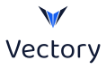

<picture>
  <source media="(prefers-color-scheme: dark)" srcset="https://raw.githubusercontent.com/VectoryLabs/.github/main/profile/assets/vectory-stacked-dark.svg">
  
</picture>

### Smarter. Simpler.
*Thông minh hơn. Đơn giản hơn.*

Vectory Labs builds AI, automation and digital products that make everyday work simpler and more effective.

[Website](https://vectorylabs.net) · [Contact](mailto:contact@vectorylabs.net)

---

## What we do

Technology should remove friction, not add it. We turn advanced AI, automation and data
capabilities into products that are **simple to use, fast to value and flexible to fit**.

| Capability | What it means |
|---|---|
| **AI** | Applied where it solves a real problem, not for its own sake |
| **Workflow automation** | Less manual entry, fewer manual approvals, less repetitive work |
| **Data & business intelligence** | Fragmented data brought together into something teams can act on |
| **System integration** | Connecting the tools teams already use: Excel, Google Sheets, Lark |
| **Digital transformation** | Practical, step-by-step change without a large technical team |

## Products

| Product | Short name |
|---|---|
| **Vectory Attendance** — attendance and time tracking | Vec Att |
| **Vectory Flow** — workflow | Vec Flow |
| **Vec Inn** | Vec Inn |

## Our values: VECTORY

**V**alue first · **E**fficient by design · **C**urious by nature · **T**echnology with purpose ·
**O**wn the outcome · **R**elentless improvement · **Y**ou at the center

## About the name

**Vector + Victory**: direction and progress toward better outcomes.

## Built with

## Contact

- 🌐 [vectorylabs.net](https://vectorylabs.net)
- ✉️ [contact@vectorylabs.net](mailto:contact@vectorylabs.net)

Most of our repositories are private. © Vectory Labs.
